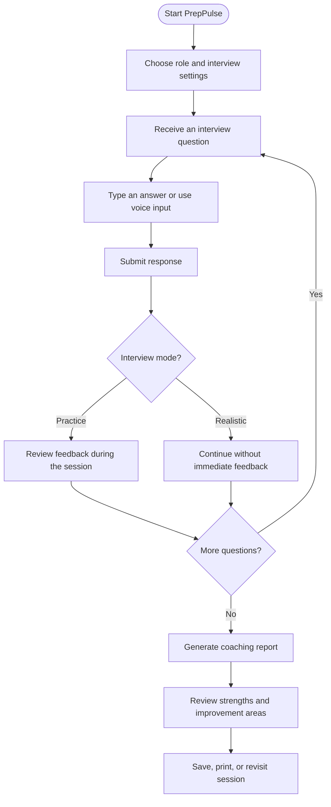
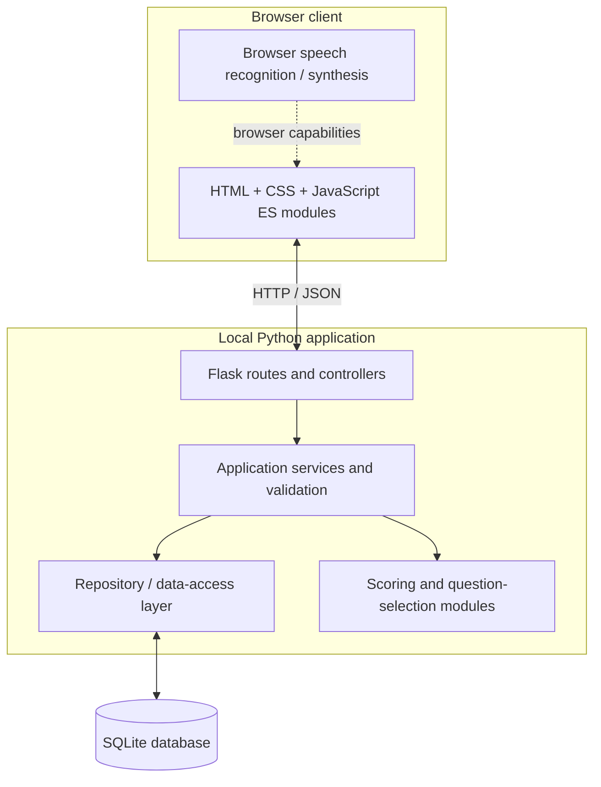

None selected

Skip to content
Using Gmail with screen readers
1 of 4,891
(no subject)
Inbox
Summarize this email

Prem Chand Velpula
10:13 AM (0 minutes ago)
to me

<div align="center">


# PrepPulse AI · Mock Interview Chatbot

### Turn interview anxiety into interview readiness.

**Prepare with purpose. Practise with feedback. Improve one answer at a time.**

A local-first interview practice app that helps you rehearse role-focused questions, answer by typing or voice, and turn each session into a practical coaching report.

<p>
  
  
  
  
</p>
<p>
  
  
  
  
</p>

**PREPARE** &nbsp; ✦ &nbsp; **PRACTISE** &nbsp; ✦ &nbsp; **REFLECT** &nbsp; ✦ &nbsp; **GROW**

</div>

---

## ✨ Table of contents

- [🌌 About the project](#-about-the-project)
- [💎 Features at a glance](#-features-at-a-glance)
- [🧭 How it works](#-how-it-works)
- [🎯 Interview modes](#-interview-modes)
- [📊 Scoring and feedback](#-scoring-and-feedback)
- [🧠 How the AI scoring works](#-how-the-ai-scoring-works)
- [🏗️ Architecture](#️-architecture)
- [🧰 Technology stack](#-technology-stack)
- [📁 Project structure](#-project-structure)
- [⚡ Installation and setup](#-installation-and-setup)
- [🧪 Testing](#-testing)
- [🔐 Privacy and security](#-privacy-and-security)
- [🛠️ Troubleshooting](#️-troubleshooting)
- [🗺️ Future improvements](#️-future-improvements)
- [🤝 Contributing](#-contributing)
- [📄 License and attribution](#-license-and-attribution)

---

## 🌌 About the project

**PrepPulse AI** is a browser-based mock interview chatbot designed to help students, job seekers, and professionals build interview confidence through structured practice. Instead of simply displaying a list of questions, the app guides you through an interview session and provides a review of your responses when you finish.

Choose a target role and interview setup, answer questions in text or with supported browser voice features, then review a report highlighting what went well and what you could improve. Session history lets you revisit earlier practice and use feedback to guide your next attempt.

### Why PrepPulse?

| Challenge | How PrepPulse helps |
|---|---|
| Not knowing what to practise | Organises questions around interview topics and target roles. |
| Feeling unprepared for interview pressure | Offers a more interview-like mode with feedback held until the end. |
| Giving answers that are unclear or unfocused | Reviews structure, relevance, reasoning, and conciseness. |
| Forgetting what to improve next | Presents a coaching report with strengths and improvement suggestions. |
| Losing track of earlier practice | Keeps session history and supports returning to saved or unfinished sessions. |

> [!NOTE]
> PrepPulse is an educational practice tool, not a hiring system. Its scores are approximate coaching signals—not objective measurements of ability, professional certification, or predictions of hiring outcomes.

## 💎 Features at a glance

<table>
<tr>
<td width="50%" valign="top">

### 🎯 Role-focused sessions

Set up practice around your target role, experience level, interview type, and preferred number of questions. The goal is to make practice feel relevant to the opportunity you are preparing for.

</td>
<td width="50%" valign="top">

### 🎙️ Type or speak

Submit written answers or use browser speech recognition where supported. You can review and correct a voice transcript before submitting it. Spoken questions are available through browser speech features.

</td>
</tr>
<tr>
<td width="50%" valign="top">

### 🧪 Two interview experiences

Choose guided **Practice** mode for feedback as you go, or **Realistic** mode to concentrate on answering first and review feedback at the end.

</td>
<td width="50%" valign="top">

### 📊 Multi-criteria evaluation

Get a weighted scorecard for role-specific correctness, relevance, clarity and structure, reasoning and evidence, and conciseness.

</td>
</tr>
<tr>
<td width="50%" valign="top">

### 📝 Coaching report

Review your overall result, answer-level feedback, strengths, areas to improve, and suggested topics for further preparation.

</td>
<td width="50%" valign="top">

### 📈 Dashboard and history

Revisit completed interviews, review progress across sessions, and return to unfinished practice where supported by the saved session flow.

</td>
</tr>
<tr>
<td width="50%" valign="top">

### 🖨️ Keep a copy of your report

Print a coaching report or save it as a PDF using your browser's print dialog, making it easier to reflect on feedback later.

</td>
<td width="50%" valign="top">

### 💻 Local-first core workflow

The Flask backend, SQLite storage, and scoring model run locally. You do not need a paid third-party AI API key for the core interview practice workflow.

</td>
</tr>
</table>

Additional project capabilities include account and guest flows, browser-based question narration, local session persistence, and launcher scripts for Windows and Unix-like systems.

## 🧭 How it works



1. **Configure your session.** Select the role and interview options that match your preparation goal.
2. **Read or listen to the question.** Follow the session progress and think through your response.
3. **Answer naturally.** Type your response or use a compatible browser's speech-recognition feature. Review the transcript if you dictate an answer.
4. **Receive feedback.** Practice mode shows feedback as you progress; Realistic mode delays the review until the session is over.
5. **Study your report.** Look at the weighted score, criterion-level results, feedback, strengths, and suggested areas to practise.
6. **Repeat with intention.** Use the history and report to choose what to work on in your next session.

## 🎯 Interview modes

<details open>
<summary><strong>🟣 Practice mode — learn while you practise</strong></summary>

Practice mode is designed for learning and iteration. You can review feedback during the interview flow, identify a weak answer while the question is still fresh, and apply the lesson to later questions.

**Best for:** getting familiar with common questions, developing answer structure, and improving gradually.
</details>

<details>
<summary><strong>🔵 Realistic mode — focus first, review later</strong></summary>

Realistic mode is intended to feel closer to a continuous interview. It keeps feedback until the final report, allowing you to concentrate on responding rather than reacting to a score after every answer.

**Best for:** rehearsing interview flow, building focus, and reviewing performance after completing a session.
</details>

## 📊 Scoring and feedback

Each answer is evaluated across five criteria. Each criterion receives a score from **0 to 5**, and the weighted result is presented on a **0–100 scale**.

| Criterion | Weight | What it considers |
|:--|--:|:--|
| **Role-specific correctness** | **30%** | Whether the response covers expected concepts relevant to the question and role. |
| **Relevance** | **25%** | How directly the response answers what was asked. |
| **Clarity and structure** | **20%** | Whether the explanation is understandable, organised, and easy to follow. |
| **Reasoning and evidence** | **15%** | Whether the answer explains its reasoning and uses examples, details, or evidence. |
| **Conciseness** | **10%** | Whether the answer stays focused without unnecessary repetition or filler. |
| **Total** | **100%** | A combined weighted coaching score. |

### How to interpret the score

- **Use the breakdown, not just the total.** Two answers can receive similar totals for very different reasons.
- **Treat feedback as a prompt for revision.** Improve the explanation, add a concrete example, or remove unrelated detail, then practise again.
- **Consider the context.** Short answers may be appropriate for some questions; detailed answers may be necessary for others.
- **Do not compare scores as if they were formal exam grades.** The model is an aid to reflection and may not understand every valid answer.

## 🧠 How the AI scoring works

PrepPulse includes a local scoring pipeline based on **scikit-learn**, including a **Random Forest** model. It processes text-derived signals and estimates scores for the five feedback criteria. The implementation includes features related to topic similarity, expected-concept coverage, answer structure, STAR-style vocabulary, evidence and numbers, filler words, hedging, and answer length. Rule-based checks help handle empty, nonsensical, or off-topic responses.

### A transparent limitation

The included model was trained on **synthetic answers**, not on a broad, independently validated dataset of human-rated interview responses. As a result, it can overlook nuance, domain-specific factual mistakes, creative approaches, and correct answers that differ from expected wording. A high score does not guarantee a strong interview performance, and a low score does not prove that an answer is wrong.

**Recommended use:** treat automated feedback as an initial review. For important career decisions, combine it with your own judgement, trusted mentors, and role-specific technical review.

## 🏗️ Architecture



### Main components

- **Frontend:** HTML, CSS, vanilla JavaScript ES modules, client-side routing, reusable UI components, and browser APIs. A frontend compilation step is not required for the normal launch flow.
- **Backend:** Flask routes and controllers connect the browser to application services, validation, authentication-related middleware, and repositories.
- **Persistence:** SQLite stores local application data such as accounts and interview sessions.
- **Scoring and question logic:** Python modules provide question data, preprocessing, model training/loading, and inference.
- **Bootstrap and launcher:** `scripts/bootstrap.py`, `run.bat`, and `run.sh` help prepare the environment and start the service.

Further technical documentation:
- [`docs/architecture.md`](docs/architecture.md) — application architecture
- [`docs/workflow.md`](docs/workflow.md) — application workflows
- [`docs/api-specification.md`](docs/api-specification.md) — API endpoints and request/response details
- [`docs/database-design.md`](docs/database-design.md) — database structure
- [`docs/requirements.md`](docs/requirements.md) — requirements and project scope

## 🧰 Technology stack

| Area | Technology | Purpose |
|:--|:--|:--|
| User interface | HTML, CSS, JavaScript ES modules | Renders the interview experience and report views. |
| Backend API | Python + Flask | Handles application requests and server-side workflow. |
| Machine learning | scikit-learn, NumPy, joblib | Supports text-feature processing and model persistence/inference. |
| Local storage | SQLite | Stores application records on the local machine. |
| Voice input/output | Browser speech APIs | Supports speech recognition and question narration where available. |
| Testing | Python `unittest`, Node.js syntax check | Checks backend/model behavior and JavaScript syntax. |
| Setup | Batch, shell, and Python scripts | Automates environment preparation and application startup. |

## 📁 Project structure

```text
mock-interview-chatbot/
├── run.bat                       # Windows launcher
├── run.sh                        # Linux/macOS launcher
├── docker-compose.yml            # Container orchestration configuration
├── scripts/
│   ├── bootstrap.py              # Environment setup and app launcher
│   └── selftest.py               # Self-test entry point
├── frontend/
│   ├── public/                   # HTML entry point and static public assets
│   ├── src/
│   │   ├── components/           # Reusable interface components
│   │   ├── context/              # Shared application/auth state
│   │   ├── hooks/                # Browser and speech helpers
│   │   ├── layouts/              # Page layout components
│   │   ├── pages/                # Home, interview, report, history, etc.
│   │   ├── routes/               # Client-side navigation
│   │   ├── services/             # Frontend API client
│   │   └── assets/               # CSS and interface assets
│   └── tests/                    # JavaScript syntax check
├── backend/
│   ├── src/
│   │   ├── controllers/          # Request handling
│   │   ├── routes/               # Flask route definitions
│   │   ├── services/             # Application logic
│   │   ├── repositories/         # Data-access functions
│   │   ├── middleware/           # Request/authentication middleware
│   │   ├── validators/           # Input validation
│   │   ├── integrations/         # Supporting integrations
│   │   └── config/               # Backend configuration
│   ├── tests/                    # Backend tests
│   └── requirements.txt          # Backend dependencies
├── ai-model/
│   ├── src/
│   │   ├── preprocessing/        # Text feature preparation
│   │   ├── training/             # Model training pipeline
│   │   ├── inference/            # Model prediction code
│   │   └── evaluation/           # Evaluation utilities
│   ├── data/                     # Question bank and question builder
│   ├── artifacts/                # Model artifacts and metadata
│   ├── tests/                    # Model tests
│   └── requirements.txt          # Model dependencies
├── database/
│   ├── schema/                   # Database schema definitions
│   ├── migrations/               # Schema migrations
│   ├── seeds/                    # Initial/reference data
│   └── data/                     # Local runtime data (generated)
├── deployment/
│   ├── Dockerfile                # Container image definition
│   └── README.md                 # Deployment notes
├── docs/                         # Project and API documentation
└── README.md                     # Project overview and setup guide
```

> Generated runtime data and secret keys should remain local. They should not be committed to source control.

## ⚡ Installation and setup

### Requirements

- **Python 3.9 or newer** (Python 3.12 is a suitable choice for the Windows bootstrap flow).
- Windows 10/11, Linux, or macOS.
- Internet access during first-time setup to install Python packages and any missing runtime prerequisites.
- A current browser. Chrome or Edge are recommended for speech recognition support.
- A working microphone and browser microphone permission if you want to use voice answers.
- **Optional:** Node.js for the frontend syntax-check command.

> The first setup may take several minutes. After dependencies and model assets are prepared, subsequent starts should usually be faster. Voice recognition is browser-dependent and may require internet access even when the core application runs locally.

### 🪟 Windows — easiest way

**Step 1 · Extract the project**

Unzip the project archive to a writable folder. For example:

```text
C:\Projects\mock-interview-chatbot
```

**Step 2 · Start the launcher**

Double-click `run.bat`, or open Command Prompt and run:

```bat
cd /d "C:\Projects\mock-interview-chatbot"
run.bat
```

During initial setup, the launcher/bootstrap flow checks for a compatible Python interpreter, creates a project-local `.venv`, installs required Python packages, prepares the scoring model, and starts the Flask server. If Python is missing, the Windows launcher may offer/attempt an installation path for Python 3.12.

**Step 3 · Open the local app**

Use the exact address printed in the terminal. The default is commonly:

```text
http://127.0.0.1:5000
```

If the default port is already in use, the app may choose a subsequent port and print that address instead.

**Step 4 · Stop the server**

When you finish practising, return to the terminal window and press **Ctrl+C**.

### 🐧 Linux / 🍎 macOS

Open a terminal in the project directory and run:

```bash
chmod +x run.sh
./run.sh
```

The launcher looks for a compatible Python version and prepares the environment. Depending on the system, setup may suggest or attempt package installation if Python is unavailable. On managed or work computers, review system-level installation prompts before approving them.

### Useful launcher options

Run these from the project root:

| Command | What it does |
|:--|:--|
| `run.bat --check` | Runs the project self-test without starting the web server. |
| `run.bat --setup-only` | Prepares the environment/model and exits. |
| `run.bat --no-browser` | Starts the server without automatically opening a browser. |
| `./run.sh --check` | Runs the self-test on Linux/macOS. |
| `./run.sh --setup-only` | Performs setup only on Linux/macOS. |
| `./run.sh --no-browser` | Starts without automatically opening the browser on Linux/macOS. |

### What if you want to run it manually?

The recommended route is to use the provided launchers because they coordinate the virtual environment, dependencies, model setup, and server startup. Manual setup can differ based on the Python version and project configuration; consult `scripts/bootstrap.py` and the dependency files before running individual modules directly.

## 🧪 Testing

Testing helps catch regressions after changing the frontend, backend, or scoring pipeline.

### 1. Check JavaScript syntax

If Node.js is installed, run from the project root:

```bash
node frontend/tests/syntax-check.mjs
```

A successful run reports that the frontend modules parse correctly.

### 2. Run the project self-test

**Windows:**

```bat
run.bat --check
```

**Linux/macOS:**

```bash
./run.sh --check
```

The self-test entry point runs the Python unit tests for the backend and AI model and runs the frontend syntax check when Node.js is available. Execute the tests in an environment where project dependencies are installed.

> **Verification status:** syntax checks and archive validation have been performed for this prepared package. The full application test suite must still be run in an environment with all project dependencies installed; a passing syntax check alone does not prove every application flow works correctly.

## 🔐 Privacy and security

PrepPulse is intended to keep its core application workflow local to your computer. The project includes password hashing, signed expiring tokens, input validation, and user-scoped data-access patterns. Still, local-first software needs careful handling.

- **Protect your account:** use a strong, unique password if you create an account.
- **Protect local data:** keep the project directory and SQLite database private, especially on shared devices.
- **Keep secrets out of Git:** never commit `.env` files, generated secret keys, access tokens, database files, or personal interview answers.
- **Understand voice input:** browser speech recognition may send audio to a browser-vendor speech service. Review your browser's privacy settings before using this feature.
- **Avoid public exposure:** do not expose the development server to a public network without reviewing the deployment and security configuration.
- **Rotate exposed secrets:** if a secret was ever committed to a public repository, rotate it and remove it from Git history; deleting it in a later commit is not sufficient.

The local SQLite database is created by the application when needed. Removing the runtime database can erase locally stored accounts and interview sessions. Back up data first if you need to keep it.

## 🛠️ Troubleshooting

<details>
<summary><strong>Python was not found</strong></summary>

Install a supported Python version and, on Windows, enable **Add Python to PATH** if offered. Reopen Command Prompt and verify the installation with `python --version` or `py -3 --version`, then run `run.bat` again.
</details>

<details>
<summary><strong>Dependency installation fails</strong></summary>

The initial setup requires internet access to download packages. Check your connection and the setup output/logs. If a proxy, firewall, or managed network blocks package downloads, use an approved network or package mirror rather than disabling security controls.
</details>

<details>
<summary><strong>The browser did not open automatically</strong></summary>

Wait for the terminal to print the local URL, then copy it into your browser. You can also start the application with `run.bat --no-browser` and open the printed URL yourself.
</details>

<details>
<summary><strong>The default port is busy</strong></summary>

The server may select a subsequent port if the default is unavailable. Always use the exact URL printed by the terminal.
</details>

<details>
<summary><strong>Voice input or question narration is unavailable</strong></summary>

Use a recent version of Chrome or Edge, allow microphone access, and check the operating system's microphone settings. Browser speech features vary by browser and may need internet access. Typing answers remains an alternative.
</details>

<details>
<summary><strong>The scoring model fails to load</strong></summary>

Review the bootstrap output and setup logs. Run the project's setup flow to let it prepare or retrain missing model assets. If you changed dependencies manually, recreate a consistent virtual environment before retrying.
</details>

<details>
<summary><strong>I want to reset the app</strong></summary>

Back up any important interview history first. Identify the runtime database and generated files before removing anything; deleting the database can erase local accounts and sessions.
</details>

## 🗺️ Future improvements

The following are possible future enhancements, not claims that they are already implemented:

- [ ] Add real screenshots and a short product walkthrough GIF.
- [ ] Evaluate the scoring model against diverse, human-reviewed answers.
- [ ] Explain more clearly which answer signals influenced each criterion score.
- [ ] Expand and review question coverage for additional roles and experience levels.
- [ ] Add more accessibility checks and keyboard-navigation tests.
- [ ] Add broader automated integration and browser tests.
- [ ] Offer user-controlled export and backup/restore workflows.
- [ ] Document a hardened deployment path for a secured hosted version.

## 🤝 Contributing

Suggestions, bug reports, and improvements are welcome.

1. Fork the repository or create your own working copy.
2. Create a focused branch for your change.
3. Make the change and add or update tests where appropriate.
4. Run the available self-tests.
5. Submit a pull request or share a clear summary of the change and any relevant test results.

For an academic submission, follow your institution's rules for attribution, collaboration, and use of AI-assisted tools.

## 📄 License and attribution

No explicit license file was present in the supplied project archive. Until a license is added, do not assume the project is open source or that redistribution and modification are automatically permitted. If you plan to publish it publicly, choose an appropriate license and include a `LICENSE` file.

## 👤 Personalise this README

Before publishing or submitting the project, consider replacing or adding these details:

| Field | What to add |
|:--|:--|
| **Author / team** | Your name or project team. |
| **Repository** | Link to your GitHub repository, if published. |
| **Demo** | A real demo link or screenshots, once available. |
| **Contact** | An optional public contact method. |
| **License** | The license you choose and include in the repository. |

---

<div align="center">

### ✦ Your next interview starts with one answer.

**PREPPULSE AI** &nbsp;·&nbsp; LOCAL-FIRST INTERVIEW PRACTICE

<sub>Made to help you prepare thoughtfully, practise consistently, and learn from every response.</sub>

</div>

